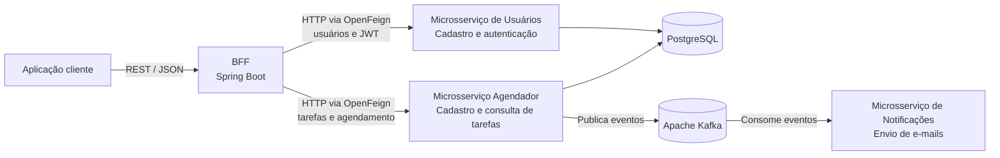

# BFF — Agendador de Tarefas

Backend For Frontend que oferece uma API única para a aplicação cliente e encaminha as operações aos microsserviços de usuários, tarefas e notificações. O BFF concentra os endpoints consumidos pelo cliente, mas delega autenticação, persistência e regras de negócio aos serviços responsáveis.

## Arquitetura

O BFF expõe os recursos de usuários (`/usuarios`) e tarefas (`/tarefas`). As chamadas aos serviços internos são feitas por HTTP com OpenFeign. O serviço de usuários emite os tokens JWT usados nas operações protegidas; o BFF encaminha o cabeçalho `Authorization` ao serviço correspondente.

O agendador é responsável pelos dados e pelo ciclo de vida das tarefas. Quando uma tarefa gera uma notificação, o agendador publica um evento no Kafka, e o serviço de notificações consome esse evento para processar o envio do e-mail. A comunicação entre o agendador e o notificador é assíncrona e ocorre pelo Kafka; o BFF não se comunica diretamente com o serviço de notificações.

## Serviços

| Serviço | Responsabilidade |
|---|---|
| **BFF Agendador de Tarefas** | API de entrada para o cliente; encaminha requisições e coordena chamadas aos microsserviços. |
| **Usuário** | Cadastro, consulta e atualização de usuários, endereços e telefones; autenticação e emissão de JWT. |
| **Agendador** | Cadastro, consulta, atualização e remoção de tarefas, incluindo consultas por período. |
| **Notificador** | Processamento e envio de notificações por e-mail a partir das tarefas agendadas. |
| **Kafka** | Recebe os eventos publicados pelo agendador e os disponibiliza ao serviço de notificações. |
| **PostgreSQL** | Persistência utilizada pelos serviços de usuário e agendamento. |

## Docker Compose

O `docker-compose.yml` orquestra o BFF, os microsserviços, o PostgreSQL e o Kafka em uma rede Docker. Os serviços internos são acessados pelos nomes dos containers e as URLs do BFF são configuradas pelas variáveis `CLIENT_URL_USUARIO`, `CLIENT_URL_TAREFA` e `CLIENT_URL_NOTIFICACAO`.

O Compose usa o `init.sql` para criar os bancos iniciais e expõe as portas configuradas no `.env`. O Kafka está disponível na porta `9092` para comunicação na rede Docker.

## Desenvolvimento

O projeto utiliza Java 21, Spring Boot, Spring Web, Spring Cloud OpenFeign, Springdoc OpenAPI e Gradle.

## Documentação
A documentação interativa da API fica disponível em `/swagger-ui/index.html` enquanto a aplicação estiver em execução.
